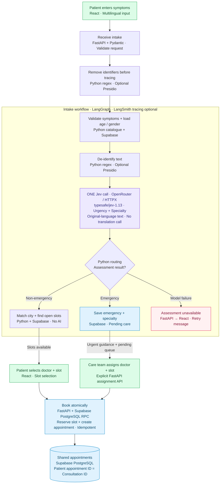
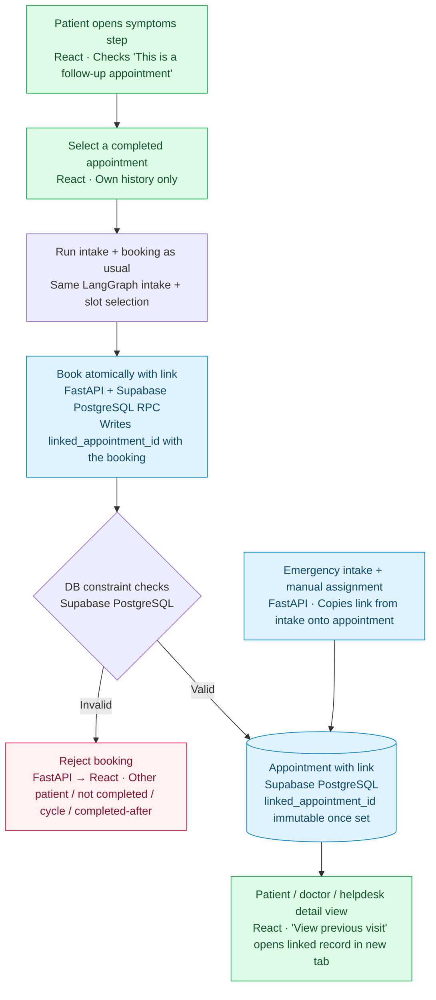
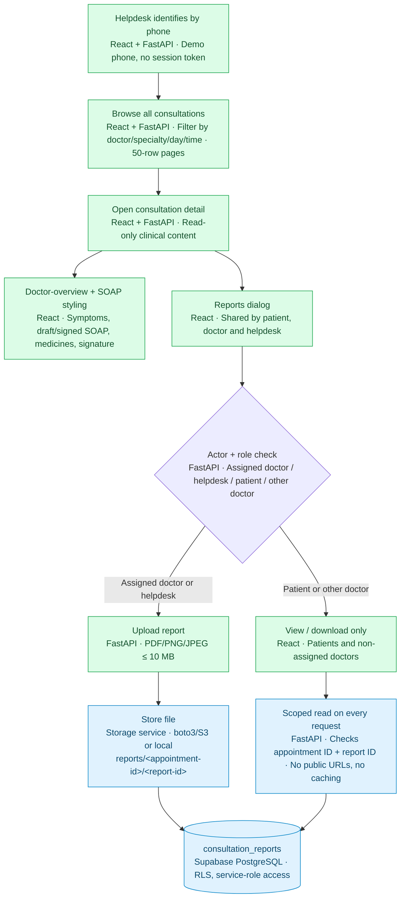
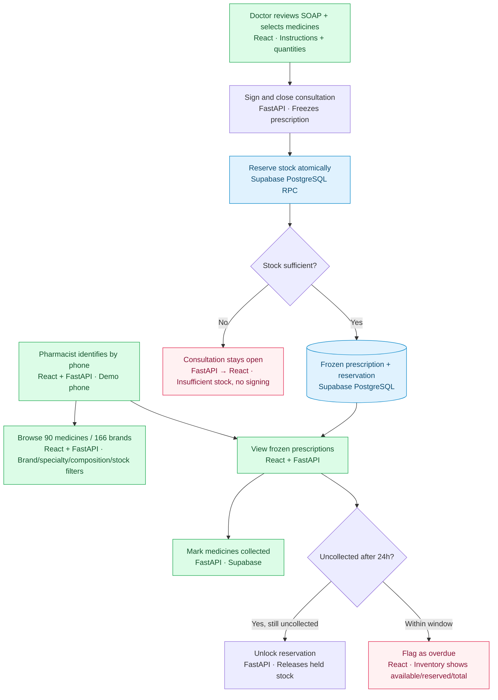
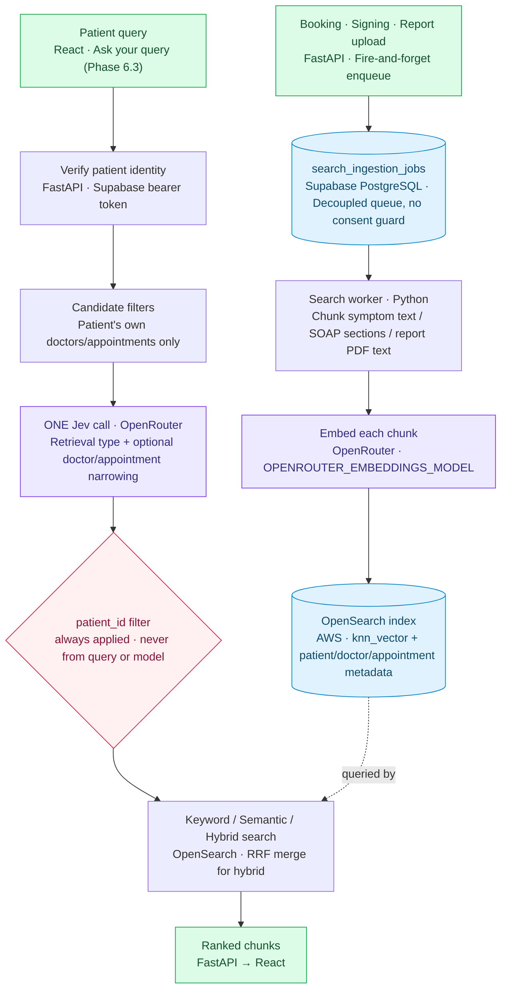
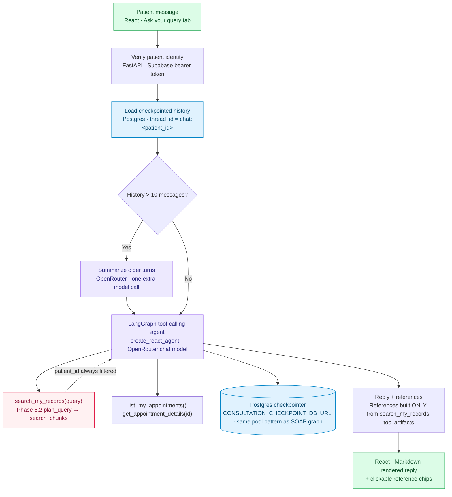

# Architecture

## Book appointment

## Consultation and SOAP

```mermaid
flowchart TD
    A[("Shared appointment<br/>Supabase PostgreSQL · Same visit ID")]
    B["Doctor opens visit + gives recording consent<br/>React + FastAPI · Signature required"]
    C["Start consultation<br/>Supabase · IN_PROGRESS"]
    D["Record → Stop → Upload<br/>Browser MediaRecorder + FastAPI"]
    D2[("Permanent audio, kept as proof<br/>Storage service · recordings/&lt;id&gt;/&lt;recording&gt; · No TTL")]
    E["Sarvam batch API · HTTPX<br/>saaras:v4 · Transcribe + Diarize<br/>Original languages · Person 1 / Person 2"]
    F["Save timestamped transcript<br/>Storage service · boto3 / S3 or local JSON"]
    G["Doctor selects Generate / Regenerate<br/>React + FastAPI · Explicit action"]
    P{"New recording arrives while<br/>SOAP is RUNNING?"}

    subgraph SOAP["SOAP workflow · LangGraph · LangSmith tracing optional<br/>Optional Postgres checkpointer · thread_id = soap:&lt;visit&gt;:&lt;job&gt;"]
        H["Validate + de-identify turns<br/>Python checks + regex · Optional Presidio"]
        I["LLM call 1 · English translation<br/>OpenRouter / OpenAI SDK<br/>OPENROUTER_MODEL · Default: google/gemini-3.8-flash<br/>Checkpointed · skipped if already resumed"]
        V["Check turn order + scrub identifiers<br/>Pydantic + Python regex / optional Presidio"]
        J["LLM call 2 · SOAP extraction<br/>OpenRouter / OpenAI SDK · Same model<br/>Rephrased clinical-note voice, never 'you'<br/>Subjective / Objective / Assessment / Plan<br/>Checkpointed · skipped if already resumed"]
        K["Validate schema · Pydantic<br/>Word-overlap grounding is advisory<br/>Logs a warning, never discards the draft"]
        H --> I --> V --> J --> K
    end

    L["Save SOAP draft<br/>Storage service · boto3 / S3 or local JSON"]
    M["Doctor reviews + saves edits<br/>React + FastAPI · Human approval"]
    N["Sign and close<br/>FastAPI · Consent + signature checks"]
    O["Save fixed SOAP + signature snapshot<br/>Storage service · boto3 / S3 or local JSON"]
    Q[("Close shared appointment<br/>Supabase · COMPLETED + snapshot reference")]
    R["Read-only signed summary<br/>React · Doctor + patient portals"]

    A --> B --> C --> D --> D2 --> E --> F --> G --> H
    D -.->|Also checks| P
    P -->|Yes| X["Supersede the running SOAP job<br/>Supabase RPC + asyncio.Task.cancel · Fails fast, SOAP re-chains after"]
    K --> L --> M --> N --> O --> Q --> R
    M -->|Apply edits| L

    classDef model fill:#ede9fe,stroke:#7c3aed,color:#312e81
    classDef data fill:#e0f2fe,stroke:#0284c7,color:#0c4a6e
    classDef human fill:#dcfce7,stroke:#16a34a,color:#14532d
    classDef alert fill:#fff1f2,stroke:#e11d48,color:#881337
    class E,I,J model
    class A,C,F,L,O,Q,D2 data
    class B,D,G,M,R human
    class X alert
```

## Follow-up appointments

## Helpdesk portal and reports

## Pharmacy fulfillment

## Search ingestion and retrieval (patient chatbot foundation)

## Patient chat agent (Phase 6.3)

Tools are rebuilt per request, closing over the already-verified
`patient_id` — the model has no tool parameter that could name a
different patient. Citations are structural, not model-claimed: only
`ToolMessage`s from `search_my_records` contribute to `references`, never
prose the model writes on its own.
